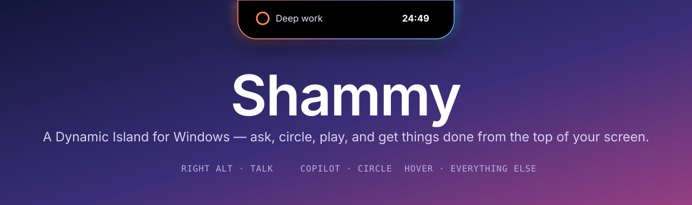
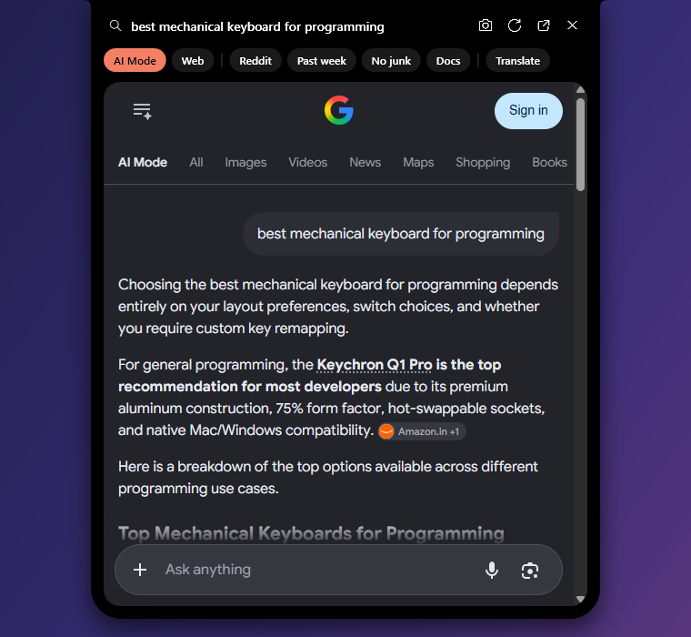
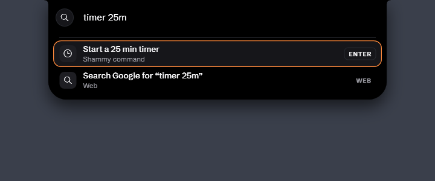
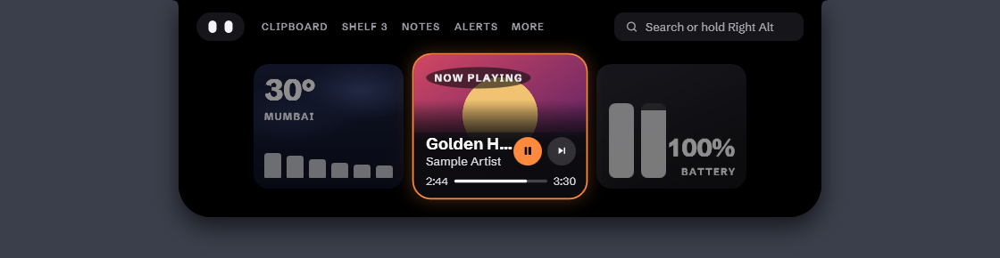
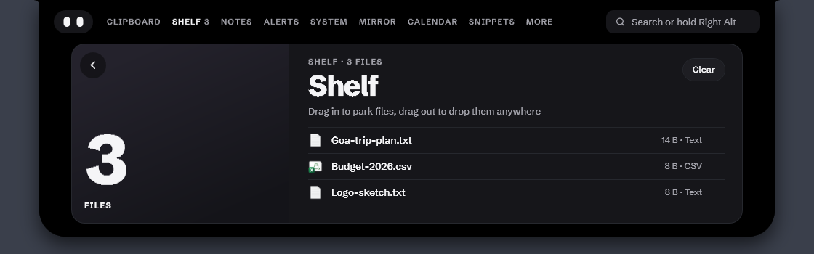
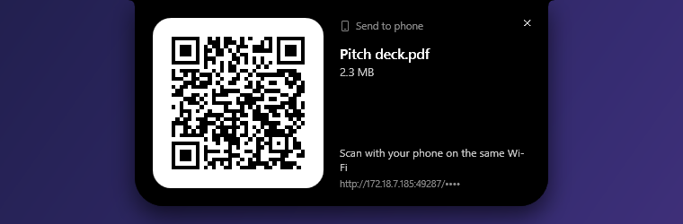

<p align="center">
  
</p>

<p align="center">
  <a href="https://github.com/Roushan-2104/Shammy-Notch-For-Windows/releases/latest"></a>
  
  
  
  <a href="LICENSE"></a>
</p>

<p align="center">
  <b><a href="#install">Install</a></b> ·
  <a href="#three-keys">Three keys</a> ·
  <a href="#a-day-with-shammy">Tour</a> ·
  <a href="#say-it-or-type-it">Commands</a> ·
  <a href="#privacy-by-default">Privacy</a> ·
  <a href="#build-it-yourself">Build</a>
</p>

---

Shammy turns the top-centre of your screen into a living notch, like the iPhone's Dynamic Island, made for Windows.

It answers questions with Google AI Mode, Web or Lens right inside the notch, lets you circle anything on screen to search it, and shows your music, timers, calls, downloads and notifications as little live pills. Hover it and it opens into a small dashboard.

It runs on your PC with **no paid AI**:
- Google does the answering.
- Speech-to-text runs offline with Whisper, tuned for Indian English and the names of apps you have installed.
- Text recognition uses Windows' built-in OCR.

<!-- DEMO: replace this comment with the demo GIF, e.g. <p align="center"></p> -->
> 🎬 **Demo video coming soon.**

## Three keys

| | Key | What happens |
|:-:|---|---|
| 🗣️ | **Hold** <kbd>Right Alt</kbd> | **Talk.** Ask a question or say a command: *"play kesariya"*, *"5 ft in cm"*, *"timer 10 minutes"*. The screen stays live. |
| ⌨️ | **Tap** <kbd>Right Alt</kbd> | **Type.** The command palette drops out of the notch: apps, files, settings, music and commands rank live as you type. |
| ⭕ | <kbd>Copilot</kbd>, or hold <kbd>Right Ctrl</kbd> | **Circle.** The screen freezes. Circle, scribble or tap anything, speak if you like, then let go. |

Everything else is a **hover** away.

> On layouts where Right Alt is AltGr (English India, German, French…), Right Alt on its own is the talk key, and AltGr + a key still types (₹, €, @). Right Ctrl only counts when held on its own, so Ctrl shortcuts are unaffected.

## A day with Shammy

<table>
<tr>
<td width="50%" valign="top">

### ☕ It starts quiet
At rest Shammy is just a black notch with a soft shadow. A thin colour edge flashes briefly when something happens:
- the album colour for a new song;
- your accent colour for a notification or timer;
- green for charging;
- red for low battery.

</td>
<td width="50%"><br></td>
</tr>
<tr>
<td valign="top">

### 💬 Ask it anything
Tap <kbd>Right Alt</kbd> to type, or hold it to speak. Questions open Google **AI Mode** right inside the notch:
- switch to **Web** or **Lens** with one click;
- add **Reddit**, **Past week**, **No junk** or **Docs** filters, or just say them;
- save the whole scrolling page as one screenshot.

</td>
<td></td>
</tr>
<tr>
<td valign="top" colspan="2">

### 🧭 One palette for everything
Tap <kbd>Right Alt</kbd> and start typing. Results rank live, keyboard first (<kbd>↑</kbd> <kbd>↓</kbd> <kbd>Enter</kbd>), and learn from what you pick:
- **Commands first:** `timer 25m`, `2+2`, `remind me at 6pm`, `weather`, each with a preview of what will happen;
- **Apps:** `spot` opens Spotify; one misheard word is forgiven ("visual studio board");
- **Files** straight from the Windows Search index. <kbd>Ctrl</kbd>+<kbd>Enter</kbd> shows the file in its folder. Hidden and developer folders stay out of the way;
- **Settings, right there:** `brightness` gives a slider, `sound` gives volume, mute and your output devices, `bluetooth` gives an on/off switch, and words like `wifi` or `night light` open the right Settings page;
- **Music:** `play …` or `… bajao` plays on YouTube Music; pause, next and previous control what's playing;
- **Google** is always the last row.

</td>
</tr>
<tr>
<td valign="top" colspan="2">

### 🪽 App wings
Hide the Windows taskbar and Shammy takes over: your apps sit beside the notch in a thin black strip at the top of every screen.
- **Pinned apps on the left, open apps on the right.** Your taskbar pins are imported once, then drag to reorder and right-click to pin or unpin.
- **It behaves like the taskbar:** click to bring an app forward, click again to minimise. An app with several windows shows a list. Right-click to close. Hold a dragged file over an app to bring it forward.
- **Maximised windows start below the strip.** It hides for full-screen apps, and gives the space back when you quit or turn it off.
- It turns on by itself when the taskbar is set to auto-hide. Toggle it from the tray any time.

</td>
</tr>
<tr>
<td valign="top">

### ⚡ Instant answers
Sums, unit and currency conversions and time zones never leave your PC: no search, no wait. Exchange rates are free and refreshed daily.

</td>
<td><br></td>
</tr>
<tr>
<td valign="top">

### ⭕ Circle to search
Press <kbd>Copilot</kbd> and the screen freezes. Circle a photo, a word or a paragraph:
- text goes to Google;
- images go to **Lens**, and a "Sent to Google" badge tells you when one leaves your PC;
- a circled **QR code** opens;
- a circled **price** converts to your currency.

</td>
<td><br><br></td>
</tr>
<tr>
<td valign="top">

### 🔔 Notifications, calmly
Other apps' notifications drop out of the notch with a soft ping instead of Windows' chime:
- **hover** to keep one on screen;
- **click** to open the app;
- **right-click** to mute that app.

During a call or while you share your screen, Shammy shows who a notification is from, but not what it says.

</td>
<td></td>
</tr>
<tr>
<td valign="top">

### ⏱️ Live activities
Timers, stopwatches, Pomodoro and focus sessions, meeting mic mute, volume and brightness, charging, Bluetooth, downloads and updates all live in the notch as small pills. When two things happen at once, one splits off into a bubble.

</td>
<td><br><br><br><br><br><br></td>
</tr>
<tr>
<td valign="top">

### 🗂️ Hover for the dashboard
Hover the notch to open it: clock, now playing, battery, and a tab for each part of Shammy:
- Shelf
- Notifications
- Weather
- Clipboard
- Lyrics
- Notes
- Snippets
- System

</td>
<td></td>
</tr>
<tr>
<td valign="top">

### 📎 The shelf
Drag files onto the notch to park them, and drag them back out into any app later. Right-click a file for **Send to phone**.

</td>
<td></td>
</tr>
<tr>
<td valign="top">

### 📱 Send to your phone
Like AirDrop, over your own Wi-Fi. Scan the QR code and the phone downloads the file in its browser, or uploads photos back into your PC's **Downloads** folder. No app, no cloud, no account.

</td>
<td></td>
</tr>
</table>

### And quietly, in the background
- 🎵 **Music:**
  - say *"play …"* to play it in YouTube Music, or *"… on spotify"*;
  - synced lyrics;
  - scroll over the notch for volume, swipe sideways to skip.
- 📋 **Clipboard:**
  - history of what you copy, with pinning;
  - a screenshot catcher you can drag into any app;
  - Wi-Fi passwords from QR codes stay out of Windows' clipboard history.
- ✍️ **Snippets:** type `;date`, `;time`, `;shrug` or your own triggers in any app and they expand.
- 🚀 **Launcher:** *"open spotify"*, *"open github.com"*, *"open downloads"*.
- 🌤️ **Ambient:** weather, a rotating cricket, stocks or crypto ticker, and a tiny notch pet.
- 🖥️ **System:**
  - a CPU, memory and battery tab;
  - alerts when an app hogs the CPU or the battery drains fast.
- 🙈 **Fullscreen:** Shammy hides itself for fullscreen games, videos and presentations, and never covers a top taskbar.

## Install

1. Download **`Shammy-Setup.exe`** from the [latest release](https://github.com/Roushan-2104/Shammy-Notch-For-Windows/releases/latest) and run it.
   - It installs for your account only, with no admin prompt.
   - .NET is included.
2. On first run, Shammy asks once whether it should **start with Windows**. You can change this later in the tray menu.

- **Updates are automatic.** Shammy downloads new versions in the background, usually just a few MB, and the notch offers *Update ready · click to restart*. If you ignore it, the update installs when Shammy next quits.
- **No installer?** `Shammy-Portable.zip` runs from any folder and updates itself the same way.
- **First launch:** Shammy downloads a small offline voice model (~148 MB) so you can talk within a minute. Typing and circling work meanwhile. It then checks your PC once and quietly fetches a sharper model in the background: about 574 MB on a PC with a usable graphics card, or 488 MB otherwise. The notch says *Voice upgraded* when it switches.
- **Hinglish voice (optional):** on a PC with a graphics card, tick *Hinglish voice (Hindi + English)* in the tray menu to switch to a model that understands Hindi mixed with English, like "kal subah 7 baje ka alarm laga do" (a one-time 574 MB download). It writes Hindi in Latin letters, and anything it isn't sure about is checked against the regular English model. It's off by default, and greyed out on PCs that run voice on the processor, where it would be too slow.

<details>
<summary><b>Requirements and first-run notes</b></summary>

- **Windows:** 10 (2004+) or 11.
- **WebView2 Runtime** for search results. It comes with Windows 11 and current Edge; if it's missing, the notch links to Microsoft's installer.
- **SmartScreen:** the build isn't code-signed yet, so SmartScreen may ask you to confirm the first run.
- **To hear only Shammy's ping,** turn off *Allow notifications to play sounds* in Settings › System › Notifications. The tray menu has a shortcut to that page.
- **Uninstall** from Settings › Apps. Your settings and data in `%LOCALAPPDATA%\Shammy` are kept.

</details>

## Say it or type it

| Say or type | What happens |
|---|---|
| `play kaahe mose` · `kesariya bajao` · `play tum hi ho on spotify` · `pause` · `next` | Plays in YouTube Music (or Spotify) · media controls. Hindi song names are checked against your listening history and a built-in list |
| `lyrics` | Synced lyrics for the current song |
| `timer 25m tea` · `stopwatch` · `pomodoro` · `focus 45m` | A live countdown in the notch |
| `remind me at 6pm to call mom` · `set an alarm for 7 am` · `kal subah 7 baje ka alarm laga do` · `note: buy milk` | A reminder card when it's due · the Notes tab |
| `5 ft in cm` · `100 usd to inr` · `5pm ist in pst` · `time in tokyo` | Instant answers |
| `translate good morning to hindi` | Google Translate |
| `open spotify` · `open github.com` · `open downloads` | App, site or folder launcher |
| `snippet ;sig Best, Roushan` · `snippets` | Text expansion in any app |
| `weather` · `ticker cricket` · `ticker stocks RELIANCE.NS` · `pet on` | Weather · ticker · notch pet |
| `mute mic` · `cpu` · `clipboard` · `send to phone` · `take a screenshot` | Mic toggle · System tab · Clipboard tab · QR transfer · Screenshot |
| *"…only from Reddit"*, *"…from the past week"*, *"…no junk"*, *"…from the docs"* | Search filters, spoken |

## Privacy by default

- **Voice and on-screen text:**
  - your voice is transcribed offline, on your PC;
  - text on screen is read with Windows' own OCR.
- **What leaves your PC:**
  - searches go to Google only when you ask;
  - the notch shows a "Sent to Google" badge whenever an image is uploaded to Lens.
- **The results browser:** it can only open web pages, so pages can't launch apps or files.
- **Notifications:** their text is hidden while an app uses your microphone or camera, or captures the screen.
- **Your data:**
  - clipboard history, notes, snippets and the song titles voice remembers are encrypted with Windows DPAPI under your account. Song memory can be cleared or turned off from the tray;
  - unpinned clipboard items are forgotten after 24 hours.
- **Logs:** they never contain what you said, searched or copied, and are kept for 3 days.
- **Phone transfers:**
  - local network only, behind a random one-time link;
  - received programs are renamed `.blocked`;
  - every received file is marked as downloaded from the internet.
- **Downloads and builds:**
  - the voice model download is pinned and checked against its SHA-256;
  - release builds contain no paths from the build machine.

<details>
<summary><b>Known limits</b></summary>

- **Google robot check.** On shared or mobile connections Google sometimes shows "I'm not a robot" in the results card. Tick it once and the browser profile remembers it.
- **Lens** uses the same upload endpoint as lens.google.com's own upload button. It isn't a public API, so it could change.
- **Brightness keys:** Shammy shows its HUD, but Windows' own brightness pop-up can't be suppressed, because the firmware handles those keys.
- **Notifications** are read when Windows' notification store changes. Clicking one opens the app, not the exact chat: Windows doesn't let other apps trigger a toast's own buttons.
- **The Copilot key** replaces Windows' Copilot/Search action while Shammy runs.
- **First launch** shows the notch about 3 s after start (WPF's one-time theme load).

</details>

## Build it yourself

```bash
dotnet test tests/Shammy.Core.Tests
dotnet run --project src/Shammy.App
```

You need Windows 10 (2004+) or 11, the .NET 8 SDK, and the WebView2 Runtime.

<details>
<summary><b>Releasing an update</b></summary>

1. Bump `<Version>` in `Directory.Build.props`.
2. Commit and push.
3. Run:

```bash
powershell -File scripts/release.ps1 -Publish
```

The script:
- builds a self-contained release;
- packages it with [Velopack](https://velopack.io), including a small delta from the previous release;
- uploads Setup, the portable zip and the update packages to a GitHub release using your `gh` login.

Without `-Publish` it only builds into `artifacts/releases`, so you can try it first.

</details>

<details>
<summary><b>How it's put together</b></summary>

```
src/Shammy.Core      pure logic, unit tested: springs, activity priority, parsers (time, money, units,
                   reminders, snippets, music), calculator, selection analysis, phone-transfer server
src/Shammy.App       WPF app
  Shell/           the notch window: state machine, spring animation, shape, colour edge
  Views/           compact pills, expanded dashboard, search bar, results and answer cards
  Search/          hotkeys, screen freeze, OCR, microphone, Whisper
  Modules/         self-contained features (music, productivity, clipboard, launcher, snippets,
                   ambient, meeting/system, phone send, screenshots, selection tools)
  Playback/        media sessions, audio visualizer
  SystemInfo/      volume, brightness, battery, Bluetooth, downloads
  Notifications/   other apps' notifications via the Windows listener
  Interop/         Win32: keyboard hook, window styles, capture
tests/             over 1,000 xUnit tests for Shammy.Core
```

Each feature is a module in `src/Shammy.App/Modules/`; its README explains how to add your own.

</details>

## License

Third-party models and libraries are credited in [THIRD-PARTY-NOTICES.md](THIRD-PARTY-NOTICES.md).

[MIT](LICENSE) © Roushan
